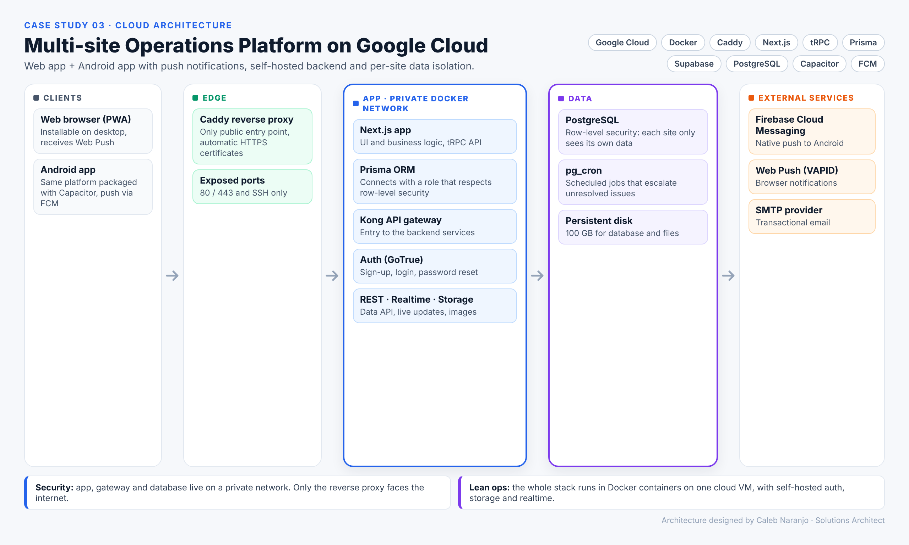
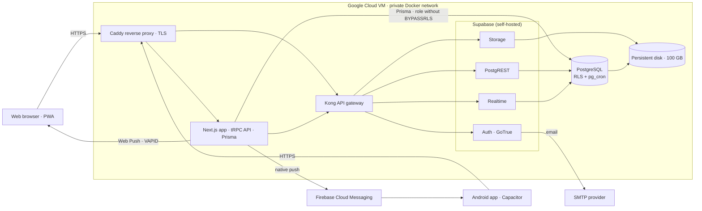

# Multi-site Operations Platform on Google Cloud

**Cloud architecture case study.** Production deployment of a web and Android platform used across several sites, with push notifications, a self-hosted backend and per-site data isolation.

> [!IMPORTANT]
> **Confidential client project.** I designed and documented this deployment for a real client. The source code, data, domains and client identity are covered by confidentiality, so this repository holds only the architecture and documentation. Names and details that could identify the client have been changed or left out.

## Overview

- **Two clients, one codebase.** An installable web app (PWA) with Web Push, and the same platform packaged as an Android app with Capacitor and Firebase Cloud Messaging.
- **One cloud VM, everything in Docker.** Caddy is the only public entry point and issues and renews HTTPS certificates automatically.
- **Self-hosted Supabase.** Authentication, data API, realtime and file storage behind a Kong gateway, with no per-seat SaaS fees.
- **Per-site isolation.** PostgreSQL row-level security makes sure each site only sees its own data.

## Architecture

## Communication flows

1. **User access.** Browser and Android app reach Caddy over HTTPS only. Caddy routes to the app and to the Supabase gateway.
2. **App to database.** The Next.js app queries PostgreSQL through Prisma over the internal Docker network, using a role that respects row-level security.
3. **App to Supabase.** Login, password recovery and image storage go through Kong.
4. **Notifications.** Native push to Android through FCM, and Web Push to the browser with VAPID keys.
5. **Email.** The auth service sends sign-up and password emails through an external SMTP provider.
6. **Scheduled jobs.** `pg_cron` runs inside PostgreSQL and escalates unresolved issues.

## Security

- Only ports 80/443 (Caddy) and 22 (SSH) are open to the internet.
- App, gateway and database live on a private Docker network.
- Data isolation is enforced by the database itself (RLS), not only by application code.

## Tech stack

Google Cloud · Docker · Caddy · Next.js · tRPC · Prisma · Supabase (GoTrue, PostgREST, Realtime, Storage, Kong) · PostgreSQL · pg_cron · Capacitor · Firebase Cloud Messaging · Web Push

## My role

Cloud architecture, deployment design and technical handover documentation.

---

**Caleb Naranjo** · Full-Stack Engineer & Solutions Architect
